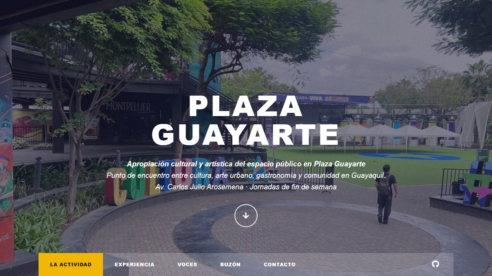
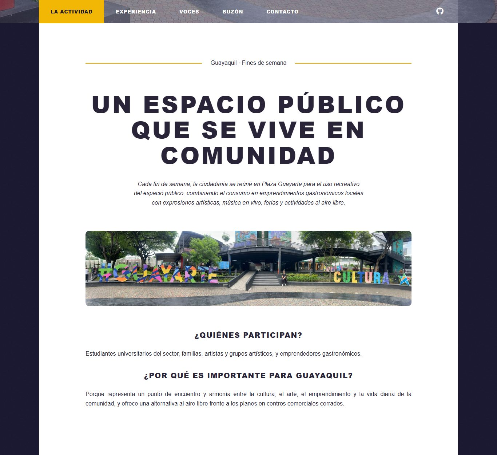
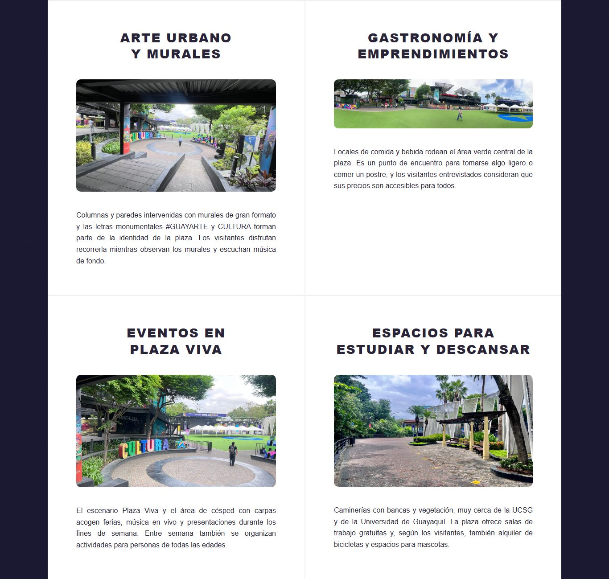
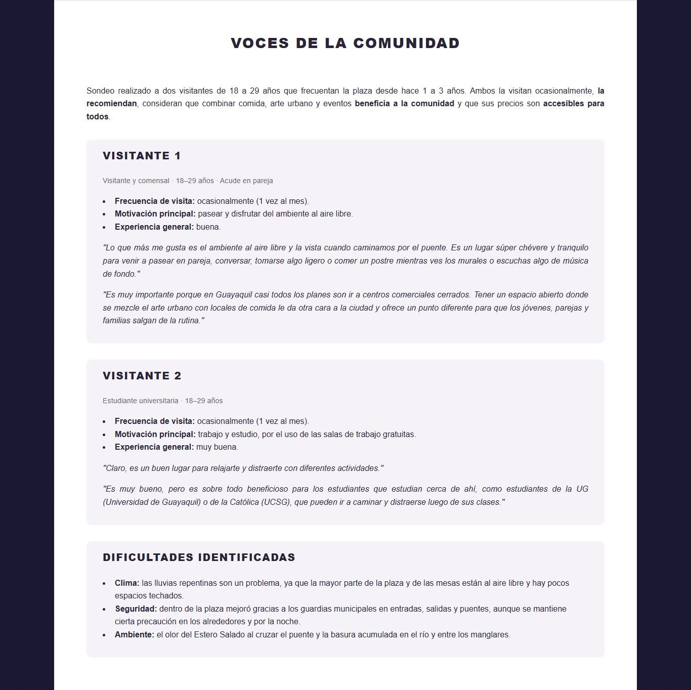
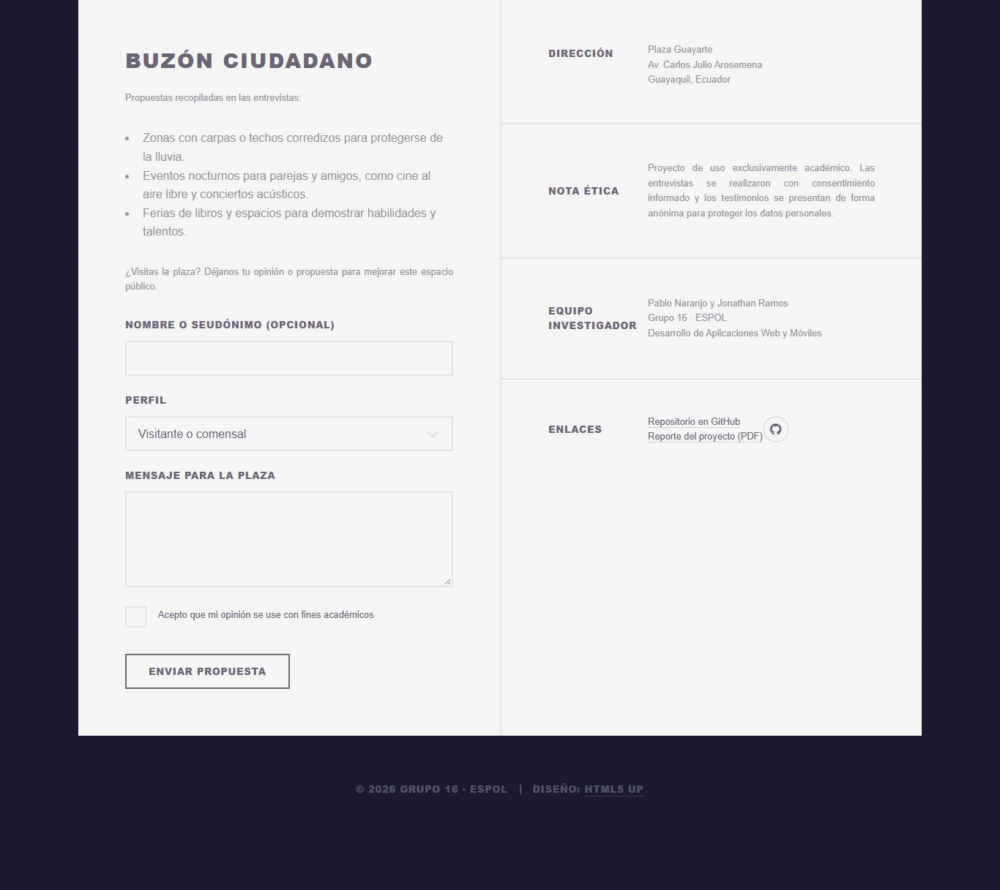
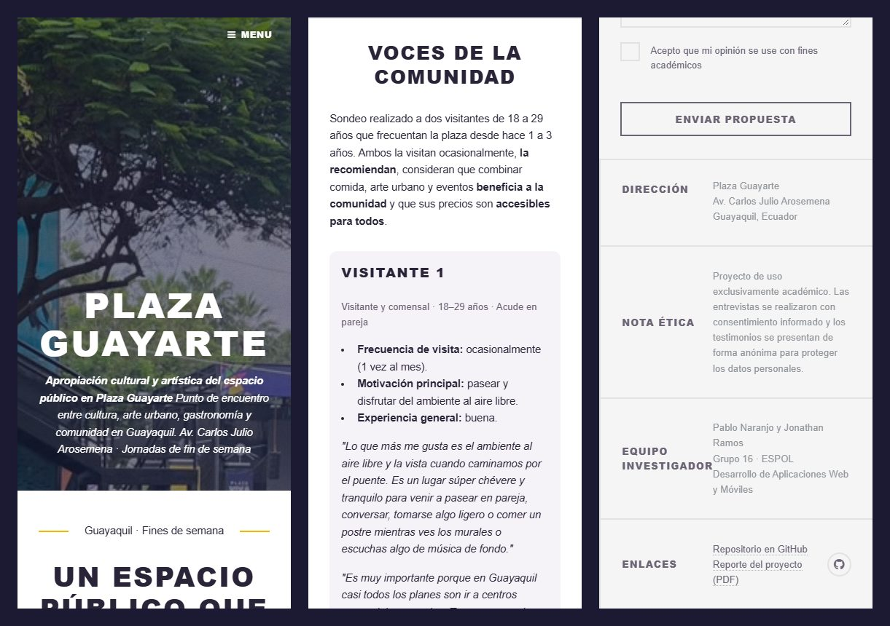

# ESCUELA SUPERIOR POLITÉCNICA DEL LITORAL
## FACULTAD DE INGENIERÍA EN ELECTRICIDAD Y COMPUTACIÓN

**Fecha:** 23 de octubre de 2026  
**Nombre de la materia:** Desarrollo de Aplicaciones Web y Móviles  
**Código de la materia:** SOFG1006  
**Proyecto:** PROYECTO 02: EXPLORANDO LA CULTURA CON LA WEB (Fase 3: Desarrollo - Sprint 2)  
**Integrantes (Grupo 16):** Naranjo Muñoz Pablo David - Ramos Macías Jonathan David  

---

## Contenido
1. [Análisis](#1-análisis)
2. [Planificación](#2-planificación)
3. [Diseño](#3-diseño)
4. [Implementación](#4-implementación)
5. [Despliegue](#5-despliegue)
6. [Bibliografía](#6-bibliografía)

---

## 1. Análisis

En la fase previa de levantamiento de información se realizó un estudio de campo y entrevistas comunitarias sobre la actividad **"Apropiación cultural y artística del espacio público en Plaza Guayarte"**, desarrollada durante los fines de semana en la Plaza Guayarte (ubicada en la Av. Carlos Julio Arosemena, Guayaquil).

Esta actividad consiste en la asistencia ciudadana para el uso recreativo del espacio público al aire libre, integrando el consumo de alimentos y bebidas en emprendimientos gastronómicos locales con expresiones artísticas, muralismo, música en vivo y ferias independientes. El levantamiento de información involucró a perfiles clave de la comunidad:
* **Visitantes y comensales.**
* **Emprendedores gastronómicos** de los contenedores y locales comerciales.

A partir de los datos recopilados (caracterización del espacio, encuestas cerradas sobre frecuencia de visita, motivación, accesibilidad de precios y nivel de satisfacción, así como testimonios abiertos sobre el impacto urbano, problemáticas como parqueo o clima, y registro multimedia), se identificó la necesidad de desarrollar una *landing page* informativa y documental. Su propósito es visibilizar la dinámica cultural y comercial de Plaza Guayarte, presentar los resultados y testimonios obtenidos en las entrevistas comunitarias, mostrar la galería multimedia del entorno y canalizar sugerencias ciudadanas para la mejora continua del espacio público.

Para el Sprint 2 se procesaron las **dos entrevistas completas** realizadas a visitantes de la plaza (rango de edad de 18 a 29 años, con 1 a 3 años frecuentándola), junto con **cinco fotografías** del entorno tomadas durante la visita de campo. Con base en la nota de consideración ética del proyecto, los testimonios se publican de forma **anónima**, identificando a cada participante únicamente por su perfil.

---

## 2. Planificación

Considerando los datos recopilados durante las entrevistas y la observación en campo en Plaza Guayarte, se determinaron seis secciones estructuradas para conformar la *landing page*. A continuación, en la **Tabla 1**, se detalla la organización del contenido indicando el nombre de cada sección, su propósito comunicacional y los datos específicos que se presentarán:

### Tabla 1: Organización del contenido de la Landing Page

| Nombre de la sección | Propósito | Datos que se presentarán |
| :--- | :--- | :--- |
| **1. Portada Principal (Header)** | Captar la atención del visitante desde el primer instante e introducir la temática central de la actividad comunitaria en Guayaquil. | - **Título oficial:** "Apropiación cultural y artística del espacio público en Plaza Guayarte". - **Subtítulo:** Punto de encuentro entre cultura, arte urbano, gastronomía y comunidad en Guayaquil. - **Ubicación y jornada:** Av. Carlos Julio Arosemena (Jornadas de fin de semana). |
| **2. Contextualización: Acerca de la Actividad (Body)** | Explicar en qué consiste la actividad comunitaria, su relevancia urbana para Guayaquil y los actores sociales que convergen en la plaza. | - Descripción del uso recreativo del espacio público al aire libre. - **Perfiles involucrados:** Estudiantes universitarios del sector, familias, artistas urbanos/músicos y emprendedores gastronómicos. - **Relevancia comunitaria:** Armonía entre el emprendimiento local, el arte y el esparcimiento diario. - Fotografía panorámica principal de Plaza Guayarte. |
| **3. Pilares de la Experiencia y Galería Multimedia (Body)** | Exhibir visualmente las actividades que motivan la asistencia ciudadana junto con la evidencia fotográfica y audiovisual levantada en campo. | - **Bloque 1: Oferta Gastronómica y Emprendimientos:** Locales de comida y bebida, ambiente accesible y puntos de encuentro. - **Bloque 2: Expresiones Artísticas y Cultura:** Música en vivo, murales de arte urbano, ferias libres y presentaciones de fin de semana. - **Evidencia multimedia:** Fotografías y videos del entorno capturados con consentimiento durante la jornada. |
| **4. Percepción Ciudadana y Resultados de Entrevistas (Body)** | Presentar los hallazgos cuantitativos y cualitativos obtenidos de las preguntas cerradas y abiertas aplicadas a los visitantes, artistas y emprendedores. | - **Estadísticas de preguntas cerradas:** Frecuencia de visita en fines de semana, motivación principal (comida, música, paseo), percepción de precios/accesibilidad y calificación general de la experiencia. - **Voces de la comunidad (Preguntas abiertas):** Lo que más disfrutan los ciudadanos, el impacto positivo para Guayaquil y las dificultades identificadas (parqueo, seguridad, clima). |
| **5. Propuestas de Mejora y Buzón Ciudadano (Body)** | Recopilar nuevas opiniones, propuestas de eventos o sugerencias de mejora por parte de visitantes, artistas o emprendedores interesados en Plaza Guayarte. | - Resumen de propuestas ciudadanas recolectadas (nuevos tipos de locales y eventos culturales deseados). - **Formulario interactivo:** Nombre o seudónimo, perfil (visitante, emprendedor, artista), y mensaje para la plaza. |
| **6. Información Logística, Ética y Créditos (Footer)** | Proveer la ubicación geográfica del espacio estudiado, la nota de consideración ética del proyecto académico y los datos del equipo investigador. | - **Dirección:** Plaza Guayarte, Av. Carlos Julio Arosemena, Guayaquil, Ecuador. - **Nota de Consideración Ética:** Declaración de uso exclusivamente académico y protección de datos personales/consentimiento informado. - **Equipo investigador:** Pablo Naranjo y Jonathan Ramos (Grupo 16 - ESPOL). - Enlaces al repositorio de GitHub y redes. |

---

## 3. Diseño

Para el desarrollo de la primera versión funcional de la *landing page*, se exploró el catálogo de plantillas gratuitas HTML5 y CSS3 del repositorio **HTML5 UP** [1]. Considerando que nuestro proyecto combina un carácter documental, fotográfico y de reportaje comunitario sobre Plaza Guayarte, se preseleccionaron tres plantillas candidatas: **Massively** [2], **Telephasic** [3] y **Photon** [4].

### Análisis comparativo de plantillas

En la **Tabla 2** se comparan las tres plantillas candidatas evaluando los cinco criterios técnicos y de experiencia de usuario solicitados:

#### Tabla 2: Cuadro comparativo de plantillas de HTML5 UP

| Criterio | Plantilla 1: Massively | Plantilla 2: Telephasic | Plantilla 3: Photon |
| :--- | :--- | :--- | :--- |
| **Estructura** | Estructura tipo revista por una portada a pantalla completa (*full-screen hero*), barra de navegación integrada, una sección principal ancha para el artículo destacado (*featured post*), una cuadrícula (*grid*) modular de 2 columnas para múltiples bloques temáticos y un *footer* dividido en formulario y datos logísticos. | Estructura corporativa tradicional multipágina con un encabezado simétrico, dos bloques promocionales superiores, un banner intermedio y una sección inferior de 3 columnas pensada para vender servicios o productos empresariales. | Estructura *one-page* minimalista dividida en bandas horizontales simples: un encabezado con ícono central, secciones alternadas de texto breve con imagen lateral, una grilla pequeña de 3 columnas y botones básicos. |
| **Navegación** | Transición suave (*smooth scroll*) desde la portada hacia el contenido mediante el botón circular de bajada, barra de navegación superior con pestañas claras y enlaces rápidos, e integración directa con el pie de página. | Utiliza un menú superior horizontal con soporte para submenús desplegables complejos (mediante jQuery Dropotron). Está diseñada para navegar entre múltiples páginas separadas más que para una lectura continua de *landing page*. | Navegación sumamente limitada: carece por completo de una barra de navegación (*navbar*) superior o lateral. El usuario depende únicamente del desplazamiento manual (*scroll*), dificultando ir directo a las entrevistas o al formulario. |
| **Diseño** | Moderno, editorial y de alto impacto visual. Emplea un fondo fijo con efecto *parallax* que resalta el contenedor central blanco, ofreciendo una jerarquía tipográfica y fotográfica ideal para crónicas urbanas, galerías de arte de Guayarte y reportajes comunitarios. | Diseño de corte empresarial clásico con degradados suaves y distribución rígida. Resulta visualmente plano y corporativo, restándole fuerza al colorido cultural, artístico y gastronómico de Plaza Guayarte. | Diseño limpio con cabeceras de fondo degradado e íconos vectoriales, pero demasiado austero. No cuenta con el dinamismo visual necesario para destacar fotografías grandes del entorno ni testimonios extensos. |
| **Adaptabilidad (*Responsive Design*)** | Altamente adaptable a dispositivos móviles, *tablets* y escritorio. Las tarjetas de la cuadrícula pasan automáticamente de 2 columnas a 1 columna vertical en teléfonos móviles, y el menú se convierte en un panel lateral deslizable (*off-canvas menu*). | Es *responsive* gracias a su sistema de grillas CSS, pero sus menús desplegables multinivel y sus bloques simétricos pierden legibilidad e impacto visual en pantallas verticales de teléfonos móviles. | Se adapta correctamente a pantallas móviles apilando los bloques en formato vertical; sin embargo, al carecer de menú móvil (*hamburger menu*), recorrer todas las secciones de la entrevista en un celular resulta poco ergonómico. |
| **Facilidad de personalización** | Muy alta. El código HTML5 es semántico y cada bloque (portada, caracterización destacada, tarjetas de actividades/entrevistas y *footer* con formulario) está encapsulado en etiquetas `<article>` y `<section>`, facilitando insertar las fotos y datos de Guayarte sin alterar el CSS. | Media. Al estar orientada a un sitio corporativo multipágina y depender de *scripts* para menús desplegables, requiere eliminar varias estructuras innecesarias para adaptarla a una *landing page* comunitaria. | Alta por la simplicidad de su código base, pero limitada funcionalmente: obligaría a programar desde cero una barra de navegación y a maquetar manualmente el formulario de sugerencias ciudadanas en el cierre. |

---

### Selección y justificación de la plantilla

* **Plantilla seleccionada:** **Massively** [2].

* **Justificación de la elección:**  
  Se seleccionó la plantilla **Massively** porque su enfoque de publicación narrativa y fotográfica responde de manera exacta a las necesidades del levantamiento de información realizado en **Plaza Guayarte**:
  1. **Enfoque de reportaje comunitario y visual:** A diferencia de *Telephasic* y *Photon*, **Massively** tiene un diseño editorial pensado para contar historias con gran respaldo fotográfico. Su portada a pantalla completa permite mostrar de fondo el ambiente artístico y colorido de los contenedores y murales de Plaza Guayarte desde el primer segundo.
  2. **Correspondencia exacta con la Tabla de Organización del Contenido:** 
     * El bloque principal **Featured Post** se adapta perfectamente para presentar la *Caracterización de la Actividad* (qué es, dónde queda y qué perfiles de la comunidad guayaquileña participan).
     * La cuadrícula modular de artículos (**Posts Grid**) permite dividir de forma ordenada los pilares de la plaza (*Oferta Gastronómica*, *Arte y Música en vivo*) y los resultados del trabajo de campo (*Estadísticas de preguntas cerradas*, *Testimonios de preguntas abiertas sobre beneficios y problemas como parqueo o clima*, y la *Evidencia Multimedia*).
  3. **Formulario y datos logísticos listos para usar:** El *Footer* de **Massively** incluye por defecto un diseño dividido que integra un formulario completo junto con los bloques de dirección física, información de los entrevistadores (Grupo 16) y la nota de consideración ética.

---

### Identidad visual

La identidad visual de la *landing page* se definió a partir de los elementos más reconocibles de la plaza: las letras monumentales multicolor **#GUAYARTE** y **CULTURA**, los murales de arte urbano y el letrero del escenario **Plaza Viva**. La **Tabla 3** resume la paleta de colores, definida como variables CSS en `:root`.

#### Tabla 3: Paleta de colores de la landing page

| Variable CSS | Color | Uso en la página | Justificación |
| :--- | :--- | :--- | :--- |
| `--color-acento` | `#d6246e` (magenta) | Enlaces y botones al pasar el cursor, campos con foco | Tomado de las letras multicolor de la plaza; reemplaza al celeste `#18bfef` de la plantilla. |
| `--color-secundario` | `#f2b705` (amarillo) | Líneas decorativas del encabezado y opción activa del menú | Segundo color de las letras de Guayarte; se usa solo en detalles para no afectar la lectura. |
| `--color-primario` | `#2b2d6e` (azul morado) | Bordes y textos de botones, casilla marcada | Inspirado en el letrero del escenario Plaza Viva. |
| `--color-fondo` | `#1c1a33` (morado oscuro) | Fondo general detrás del contenido | Armoniza con el azul morado y oscurece la fotografía de fondo. |
| `--color-texto` | `#2a2438` | Texto y títulos | Tono oscuro con matiz morado, coherente con la paleta. |
| `--color-texto-suave` | `#6b6475` | Textos del pie de página y datos secundarios | Gris violáceo para información de menor jerarquía. |
| `--color-superficie` | `#ffffff` | Contenedor central de contenido | Se mantiene el blanco de la plantilla para resaltar las fotografías. |
| `--color-fondo-claro` | `#f6f3f8` | Fondo de los bloques de resultados de entrevistas | Diferencia cada bloque sin recurrir a bordes llamativos. |

Se verificó el contraste de las combinaciones principales: texto sobre blanco (14.9:1), magenta sobre blanco (4.8:1), azul morado sobre blanco (12.3:1), texto suave del pie (5.2:1) y texto oscuro sobre amarillo (9.3:1). Todas superan la relación mínima de 4.5:1 recomendada para texto normal.

* **Tipografía:** se reemplazaron las fuentes externas de la plantilla (Merriweather y Source Sans Pro, cargadas desde Google Fonts) por fuentes del sistema: `Arial, Helvetica, sans-serif` para el texto y `"Arial Black", Arial, Helvetica, sans-serif` para los títulos, cuyo trazo grueso evoca la estética de afiche urbano. Esto además evita descargar fuentes externas.
* **Fondo:** la textura gris original (`bg.jpg`) se sustituyó por la fotografía `guayarte-cultura-escenario.jpg`, que muestra las letras CULTURA y el escenario Plaza Viva, con una capa morada semitransparente que garantiza la legibilidad del texto blanco de la portada.
* **Espaciado:** se definieron las variables `--radio` (10px), `--espacio-pequeno` (8px), `--espacio-medio` (16px) y `--espacio-grande` (32px) para mantener márgenes y rellenos consistentes.

---

## 4. Implementación

### 4.1 Integración de la plantilla (Sprint 1)

Para construir la primera versión funcional de la *landing page*, se descargó el paquete oficial de la plantilla **Massively** desde HTML5 UP y se integró su estructura completa de directorios y archivos dentro del repositorio del proyecto (`index.html`, `generic.html`, `elements.html`, `assets/css/`, `assets/js/`, `assets/sass/`, `assets/webfonts/` e `images/`), verificando que todas las dependencias locales funcionen sin errores.

### 4.2 Incorporación del contenido real en `index.html` (Sprint 2)

Se modificó el archivo `index.html` para incorporar la información real de la actividad, conservando una estructura HTML semántica (`header`, `nav`, `article`, `section`, `figure`, `footer`) y una jerarquía de encabezados adecuada: un único `h1` en la portada, un `h2` por cada bloque principal y `h3` para los subtemas. La **Tabla 4** muestra la correspondencia entre las secciones planificadas en la Tabla 1 y los bloques de la plantilla.

#### Tabla 4: Correspondencia entre secciones planificadas y estructura HTML

| Sección (Tabla 1) | Bloque de Massively | Identificador | Contenido incorporado |
| :--- | :--- | :--- | :--- |
| 1. Portada principal | `#intro`, `#header`, `#nav` | `intro` | Título "Plaza Guayarte", título oficial, subtítulo, ubicación y jornada; menú con enlaces internos a cada sección. |
| 2. Acerca de la actividad | `article.post.featured` | `actividad` | Descripción de la actividad, perfiles participantes, relevancia para Guayaquil y fotografía panorámica. |
| 3. Pilares de la experiencia | `section.posts` | `experiencia` | Cuatro artículos con fotografía: arte urbano y murales, gastronomía y emprendimientos, eventos en Plaza Viva, y espacios para estudiar y descansar. |
| 4. Percepción ciudadana | `section` nueva | `voces` | Resultados de las preguntas cerradas, testimonios textuales anónimos de los dos visitantes y dificultades identificadas (clima, seguridad y ambiente). |
| 5. Buzón ciudadano | `#footer > section` | `buzon` | Propuestas recopiladas en las entrevistas y formulario con seudónimo, perfil, mensaje y casilla de aceptación. |
| 6. Información logística | `section.split.contact` y `#copyright` | `contacto` | Dirección, nota ética, equipo investigador y enlaces al repositorio y al reporte. |

Adicionalmente se realizaron los siguientes cambios:

* **Metadatos:** se agregaron `lang="es"`, `<meta name="description">` y un `<title>` descriptivo; se retiró `user-scalable=no` del *viewport* para permitir el zoom en dispositivos móviles.
* **Imágenes:** las fotografías se renombraron con nombres descriptivos en minúsculas y sin espacios (por ejemplo, `guayarte-pasillo-murales.jpg`), y cada imagen se ubicó dentro de un elemento `<figure>` con un texto alternativo (`alt`) descriptivo.
* **Formulario:** se utilizó `method="get"`, etiquetas `<label for>`, un `<select>` para el perfil y validaciones `required` y `minlength`. Dado que GitHub Pages solo aloja sitios estáticos, el formulario valida los datos en el navegador, pero no los almacena; su procesamiento queda como trabajo futuro.
* **Eliminación del contenido de demostración:** se retiraron los textos de ejemplo, la paginación ficticia, los íconos de redes sociales sin enlace, las páginas `generic.html` y `elements.html`, y las imágenes `pic01.jpg` a `pic09.jpg` y `bg.jpg`.

### 4.3 Personalización del diseño CSS

Se identificaron las hojas de estilo de la plantilla: `assets/css/main.css` (estilos principales, generados a partir de los archivos de `assets/sass/`), `assets/css/noscript.css` (estilos aplicados cuando JavaScript está desactivado) y `assets/css/fontawesome-all.min.css` (íconos). Las modificaciones se realizaron directamente sobre `main.css` y `noscript.css`. Como consecuencia, los archivos de `assets/sass/` ya no reflejan los estilos vigentes y se conservan únicamente como parte de la plantilla original.

En primer lugar, se agregó al inicio de `main.css` un bloque `:root` con variables CSS y se reemplazaron los valores literales de color de la plantilla por `var(...)` (por ejemplo, el color de acento `#18bfef` aparecía 34 veces). De esta forma, un cambio de identidad visual se realiza editando una sola línea. La **Tabla 5** resume los selectores modificados.

#### Tabla 5: Selectores de la plantilla modificados

| Archivo | Selector | Propiedad | Valor original | Valor nuevo |
| :--- | :--- | :--- | :--- | :--- |
| `main.css` | `@import` (línea 2) | Fuentes externas | Google Fonts (Merriweather, Source Sans Pro) | Eliminado |
| `main.css` | `body, input, select, textarea` | `font-family` / `font-weight` / `line-height` | `"Merriweather", Georgia, serif` / `300` / `2.375` | `var(--fuente-texto)` / `normal` / `1.6` |
| `main.css` | `input[type="checkbox"] + label, input[type="radio"] + label` | `font-family` | `"Merriweather", Georgia, serif` | `var(--fuente-texto)` |
| `main.css` | `h1, h2, h3, h4, h5, h6` y otros 9 selectores (`.button`, `label`, `#header .logo`, `#nav ul.links`, `#copyright`, etc.) | `font-family` | `"Source Sans Pro", Helvetica, sans-serif` | `var(--fuente-titulos)` |
| `main.css` | `a:hover`, `.button:hover`, `input:focus`, `#nav a:hover`, entre otros | `color`, `border-color`, `box-shadow` | `#18bfef` | `var(--color-acento)` → `#d6246e` |
| `main.css` | `body`, `a`, `h1`–`h6`, `label`, `strong` | `color` | `#212931` | `var(--color-texto)` → `#2a2438` |
| `main.css` | `.button`, `button`, `input[type="checkbox"]:checked + label:before` | `color`, `box-shadow`, `background-color` | `#212931` | `var(--color-primario)` → `#2b2d6e` |
| `main.css` | `#footer` y elementos del pie | `color` | `#717981` | `var(--color-texto-suave)` → `#6b6475` |
| `main.css` | `#wrapper > .bg` | `background-color` | `#212931` | `var(--color-fondo)` → `#1c1a33` |
| `main.css` | `#wrapper > .bg` | `background-image` | `bg.jpg` con capa `rgba(0, 0, 0, 0.1)` | `guayarte-cultura-escenario.jpg` con capa `rgba(28, 26, 51, 0.55)` |
| `main.css` | `#wrapper.fade-in:before` | `background` | `#1e252d` | `var(--color-fondo)` |
| `main.css` | `#main` | `background-color` | `#ffffff` | `var(--color-superficie)` |
| `main.css` | `header.major .date:before, header.major .date:after` | `border-top-color` | `#eeeeee` | `var(--color-secundario)` → `#f2b705` |
| `main.css` | `header.major > .date:before, header.major > .date:after` | `width` | `calc(50% - 6rem)` | `calc(50% - 8rem)` |
| `main.css` | `#nav ul.links li.active` | `background-color` | `#ffffff` | `var(--color-secundario)` |
| `main.css` | `#footer > section.split.contact > section > :first-child` | `width` | `6rem` | `8.5rem` |
| `noscript.css` | `#wrapper` | `background-color` / `background-image` | `#212931` / `bg.jpg` | `#1c1a33` / `guayarte-cultura-escenario.jpg` |

Finalmente, se añadió al final de `main.css` una sección de reglas propias para los elementos incorporados en el Sprint 2 (**Tabla 6**). Al ubicarse al final del archivo, estas reglas prevalecen sobre las de la plantilla con igual especificidad.

#### Tabla 6: Reglas CSS agregadas

| Selector | Propiedades | Propósito |
| :--- | :--- | :--- |
| `img` | `max-width: 100%`, `height: auto`, `border-radius` | Evitar que las imágenes desborden su contenedor y suavizar sus esquinas. |
| `.item` | `padding`, `margin-bottom`, `background-color`, `border-radius` | Presentar como bloques los resultados de cada entrevista y las dificultades identificadas. |
| `.item p, .item ul` | `margin-bottom` | Uniformar el espaciado interno de los bloques. |
| `.meta` | `color`, `font-size` | Mostrar el perfil del entrevistado como dato secundario. |
| `input:focus, select:focus, textarea:focus` | `box-shadow` | Indicar visualmente el campo activo del formulario. |
| `#nav a:focus-visible, button:focus-visible` | `outline`, `outline-offset` | Mejorar la navegación con teclado. |
| `@media screen and (max-width: 736px)` | `text-align: left` en `p`; `padding` en `.item` | Evitar los espacios irregulares del texto justificado en pantallas pequeñas. |

### 4.4 Control de versiones

Las modificaciones se registraron de forma incremental mediante *commits* descriptivos en la rama `cambio_info`, que posteriormente se integró a la rama principal `main`. La **Tabla 7** presenta el historial del repositorio.

#### Tabla 7: Historial de commits

| Commit | Autor | Fecha | Descripción |
| :--- | :--- | :--- | :--- |
| `0ca20b3` | Jonathan Ramos | 16/10/2026 | Initial commit |
| `e209db7` | Pablo Naranjo | 16/10/2026 | chore: importar plantilla web base |
| `2e14502` | Pablo Naranjo | 17/10/2026 | docs: agregar reporte del Proyecto 02 (Sprint 1) en PDF y actualizar README.md |
| `2f3061f` | Jonathan Ramos | 22/10/2026 | Imagenes de la visita a la Plaza Guayarte |
| `3044774` | Jonathan Ramos | 23/10/2026 | Informacion sobre la Plaza Guayarte recopilada en las visitas |
| `ddfa9f2` | Jonathan Ramos | 23/10/2026 | Cambiando informacion de la plantilla a informacion real de la Plaza Guayarte |
| `937a45e` | Jonathan Ramos | 23/10/2026 | Informacion de las entrevistas recopiladas de forma anonimas y niveles de satisfacción |
| `4bdeb55` | Jonathan Ramos | 23/10/2026 | Cambios de informacion y cambio en el formulario |
| `3db7fea` | Jonathan Ramos | 23/10/2026 | Eliminacion de detalles que venian en la plantilla y definicion de colores de la pagina como un :root al inicio del main.css |
| `fe1e140` | Jonathan Ramos | 23/10/2026 | Implementacion de la paleta de colores, las fuentes y espacios dentro de la pagina web |

### 4.5 Resultado

Las siguientes capturas muestran la versión final de la *landing page* en escritorio (1366 px de ancho) y en un teléfono móvil (375 px de ancho).

**Figura 1:** Portada con la fotografía de la plaza y el menú de navegación.

**Figura 2:** Sección "Acerca de la actividad".

**Figura 3:** Pilares de la experiencia.

**Figura 4:** Voces de la comunidad.

**Figura 5:** Buzón ciudadano y pie de página.

**Figura 6:** Vista en teléfono móvil.

---

## 5. Despliegue

El control de versiones, el código fuente y la documentación del proyecto se gestionan en un repositorio público en **GitHub** [5], y la versión final se publica mediante **GitHub Pages** [8].

* **URL del Repositorio en GitHub:** [https://github.com/JonathanRamos24/Proyecto_DAWM_2](https://github.com/JonathanRamos24/Proyecto_DAWM_2)
* **URL pública de la landing page:** [https://jonathanramos24.github.io/Proyecto_DAWM_2/](https://jonathanramos24.github.io/Proyecto_DAWM_2/)
* **Documento de Reporte (PDF):** incluido en la carpeta `docs/` del repositorio y enlazado desde el pie de página de la *landing page*.

**Configuración de GitHub Pages:** en el repositorio se accedió a *Settings → Pages* y, en *Build and deployment*, se seleccionó *Source: Deploy from a branch*, la rama `main` y la carpeta `/ (root)`. La publicación se completa mediante el flujo *pages build and deployment* de la pestaña *Actions*.

#### Tabla 8: Verificación de la landing page publicada

| Elemento verificado | Resultado |
| :--- | :--- |
| Carga de la página principal | Pendiente |
| Hojas de estilo (`main.css`, íconos) | Pendiente |
| Imágenes de la plaza y fondo | Pendiente |
| Enlaces del menú a cada sección | Pendiente |
| Enlaces al repositorio y al reporte PDF | Pendiente |
| Visualización en dispositivos móviles | Pendiente |

---

## 6. Bibliografía

[1] AJ, "HTML5 UP! Responsive HTML5 and CSS3 Site Templates," *HTML5 UP*, 2026. [En línea]. Disponible en: https://html5up.net/.

[2] AJ, "Massively - HTML5 UP," *HTML5 UP*, 2026. [En línea]. Disponible en: https://html5up.net/massively.

[3] AJ, "Telephasic - HTML5 UP," *HTML5 UP*, 2026. [En línea]. Disponible en: https://html5up.net/telephasic.

[4] AJ, "Photon - HTML5 UP," *HTML5 UP*, 2026. [En línea]. Disponible en: https://html5up.net/photon.

[5] GitHub, Inc., "GitHub Documentation," *GitHub Docs*, 2026. [En línea]. Disponible en: https://docs.github.com/.

[6] MDN Web Docs, "HTML: Lenguaje de marcado de hipertexto," *Mozilla*, 2026. [En línea]. Disponible en: https://developer.mozilla.org/es/docs/Web/HTML.

[7] MDN Web Docs, "CSS," *Mozilla*, 2026. [En línea]. Disponible en: https://developer.mozilla.org/es/docs/Web/CSS.

[8] GitHub, Inc., "Acerca de GitHub Pages," *GitHub Docs*, 2026. [En línea]. Disponible en: https://docs.github.com/es/pages/getting-started-with-github-pages/about-github-pages.
